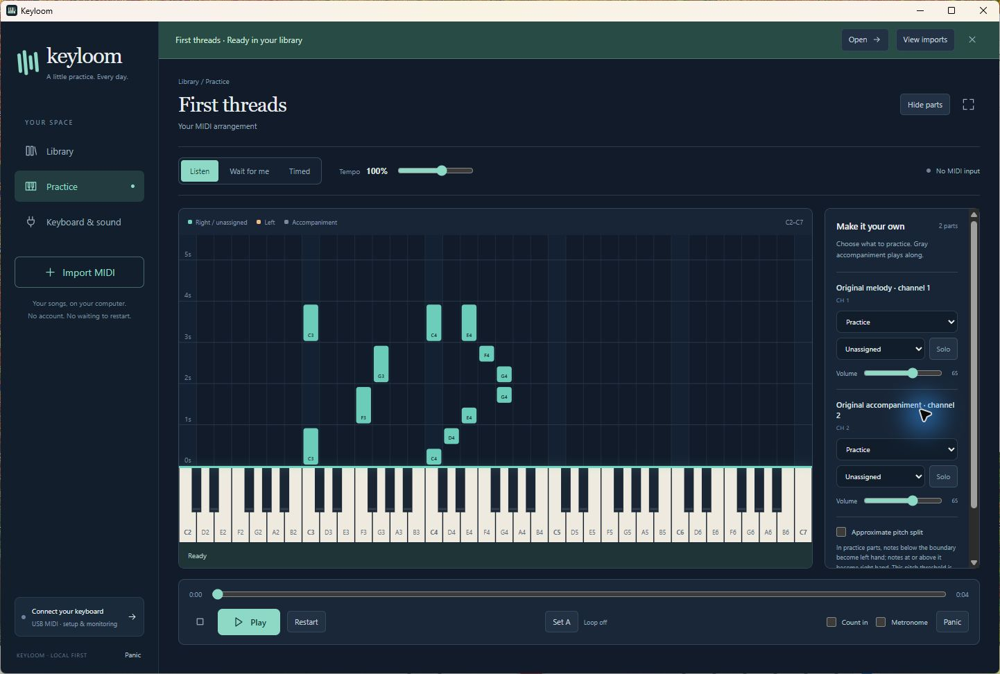

# Keyloom

An original, offline Windows piano trainer built with Tauri 2, Rust, React, TypeScript and Canvas. Import a MIDI, open it immediately, and practice through a native USB MIDI input.



- **Practice modes:** Listen, Wait for me (the song waits for the right keys) and Timed, with A–B loops, speed, count-in and metronome.
- **Your own MIDI library:** import or drop `.mid` files; they are copied into a local library, never moved or uploaded.
- **Practice versions:** make an easier copy of a song — remove notes, move them by a semitone or octave, thin chords, or fit a part to your keyboard's range — with Undo, while the original stays untouched. Export the result as a new MIDI file.
- **Yamaha Light Guide:** optionally lights the next keys to play on a Yamaha EZ-150 over MIDI.
- **Offline and private:** no account, server, cloud or internet connection is used.

## Requirements

Windows 11 x64 with the Microsoft Edge WebView2 Evergreen Runtime (included with Windows 11). Keyloom does not download or install WebView2. No administrator access, Python, Node, Rust or account is needed to run a built copy.

Builds are currently unsigned, so Windows may show a security warning. Do not bypass it unless you trust where the build came from; you can always build from source instead.

## Run

In an extracted portable package, double-click `Keyloom.exe`. With the installer, start Keyloom from the Start menu.

1. Choose **Import MIDI** or drop `.mid` / `.midi` files into the window. The result exposes **Open**, even when search or Favorites hides the song.
2. Open **Keyboard & sound**, refresh devices, select your USB MIDI interface, and connect it. Select Yamaha speakers or PC basic-tone monitoring. Optional Light Guide output is configured separately. Imported SysEx/configuration messages and MIDI Thru are never sent to the keyboard.
3. Set the keyboard's actual lowest/highest keys, or use the endpoint learning buttons. The initial range is only a display starting point; it is not a detected key count.
4. Open **Practice**, select Listen, Wait for me, or Timed, assign parts, and press Play. Play as a note's leading edge reaches the **bright pink line above the keys**. In Wait mode all target pitches require fresh key presses; the pedal does not satisfy notes. For a combined part, the adjustable pitch split is an approximate left/right guide and practice filter, not melody extraction.
5. Use Pause, Restart, Stop, seek, A–B loops, speed, count-in/metronome, or Panic as needed. Keyboard, part, loop, speed and position settings persist.

**Basic practice tone** is a generated synth sound, not a sampled piano. Your keyboard's own speakers are the default player-monitoring choice. Accompaniment and Listen playback use the PC tone. SoundFonts and authentic General MIDI instrumentation are not included.

## Yamaha EZ-150 Light Guide

Connect the USB adapter's **OUT** plug to the Yamaha's **MIDI IN** (keep the existing Yamaha OUT → adapter IN connection for your playing). On the Yamaha, press **OVERALL** until **o1**, select **On**, and stop any built-in song playback. Yamaha documents channel-1 illumination on page 54 and its Light Guide setting on page 42 of the [EZ-150 manual](https://usa.yamaha.com/files/download/other_assets/0/320940/EZ150E.pdf).

In **Keyboard & sound**, choose the USB interface under **MIDI output**, then **Connect output**. **Test middle C** sends MIDI note 60 on channel 1 for two seconds and pauses practice. Turn on **Light Guide** there or in Practice. It lights the current target chord in Wait for me, or during Timed's matching window. Listen sends no guide notes; muted/accompaniment/percussion and notes outside your configured key range are excluded. Note messages can also sound the keyboard.

Guide notes clear on pause, stop, seek, song/settings changes, guide disable, output disconnect, Panic and normal app exit. Reconnecting sends channel-1 Note Offs to clear interrupted notes. Keep other apps' MIDI Thru/echo off: returned MIDI has no marker proving whether it came from physical keys. Keyloom never routes guidance internally into player input, and simulated on-screen/computer keys monitor only; they cannot satisfy targets or score.

**Light Guide mutes all Keyloom PC audio** so you can listen to the Yamaha: key-press tones, Listen/accompaniment, count-in and metronome are silent while the toggle is on. Turn Light Guide off to restore PC audio. Your Yamaha/computer listening choice is retained, and the mute survives restart. This changes PC sound only; MIDI guide notes may still sound the Yamaha itself.

## Library and files

### Make an easier practice version

Open a song and choose **Save practice version**, give the copy a name, then **Create practice version**. It appears in the same library and has its own practice settings. The **Lesson version** selector switches between the original and its versions.

In a practice version, choose **Edit notes**. Playback pauses while you select notes on the roll or in the note list. **Semitone down/up** moves the selection by one semitone; **Octave down/up** moves it by twelve. Selection stays active for repeated moves. **Remove selected notes** removes the selection, and **Undo edit** reverses either kind of edit. Use **Done editing** to return to practice. Note timing and duration stay unchanged. A whole move is disabled if any selected pitch would leave MIDI 0–127; notes are never clamped. Keyboard-range warnings still allow deliberate moves outside your physical range.

Immediate note moves and removals save when pressed; preview tools below save only after Apply. Mixed Undo history survives restarts, retaining up to 100 actions and 200,000 individual note-change entries; large selections can retain fewer actions. Saving another practice version copies its current removals and pitches with fresh Undo history. The imported original stays unchanged. Existing original libraries and 0.2.0 practice versions remain compatible.

### Preview a simpler or more reachable part

The 0.4.0 tools are under **Simplify and fit** in a practice version's note editor. For chord thinning, choose **All pitched parts** or one nonpercussion part, then a strategy:

- **Highest note** keeps one note at each exact onset tick.
- **Bass + highest** keeps one note at each of the lowest and highest distinct pitches; a unison keeps one.
- **Limit highest notes** keeps the highest N note events, from 1 to 8. Equal-pitch events count separately toward N; ties keep the lower stable note ID.

Choose **Preview chord thinning** to inspect the result. All pitched parts are considered jointly when that scope is selected. Percussion is excluded, and notes that begin even one tick apart are separate groups. This is a pitch-based simplification heuristic, not melody extraction; it may remove musical material you want to keep.

To fit your keyboard, use **Select all outside range**, **Select below range**, or **Select above range**. These replace the selection using every surviving pitched note in the current version, independent of the note-list page/filter and visible roll. A note on either configured endpoint is in range. Choose **Preview octave down** or **Preview octave up** to inspect a twelve-semitone move; a move beyond MIDI 0–127 is refused rather than clamped.

The preview shows every proposed pitch change or removal in a paginated list and switches the roll between **Before** and **After**. **Cancel preview** saves nothing. **Apply preview** saves the entire batch as one **Undo edit** action after checking that the saved version has not changed. Previewing does not play simulated notes, alter the original or change the saved lesson. Existing immediate semitone/octave buttons still save as soon as you press them; only the explicitly labeled preview tools wait for Apply. Finish editing to practice the applied result.

After is shown first. Other edits, Undo and export are disabled while a preview is open; apply or cancel it before continuing. Changing the tool options, range selection, keyboard range or lesson discards the previous preview so it cannot be applied to a different setup.

Choose **Export MIDI** in the practice-version toolbar or arrangement details to save a **new** file. A version export includes all saved notes at original tempo; practice speed, part roles, hand split and loops do not alter the file. Original-song export remains byte-exact. Version export preserves source timing and non-note events, but does not retarget expressive pressure to moved pitches. Ambiguous overlapping same-pitch releases and empty versions cannot be exported; see [MIDI policy](docs/midi-policy.md).

### Where your data lives

Versions store their edits separately and refer to the original's managed MIDI. Remove dependent versions before removing that original from the library. Application data lives under `%LOCALAPPDATA%\io.github.mythicruntime-lab.keyloom`: `library.sqlite3`, managed `midi` originals and preferences. Builds up to 0.4.0 used `%LOCALAPPDATA%\app.keyloom.desktop`; to keep a library from one of those, close Keyloom and copy that folder's contents into the new one. Source files are copied, never moved. Byte-identical files share one entry; different arrangements remain separate. Export refuses existing destination files. Removal asks for confirmation and deletes only the managed copy/record, never the external original. Keep the data directory when updating. Uninstall can retain this library; do not select an offered application-data deletion option if you want to keep your songs.

MIDI 0/1 with musical tick division are supported. Type 2 and SMPTE division receive explicit unsupported-format errors. See [MIDI policy](docs/midi-policy.md) for malformed input, event budgets, tempo conflicts, sustain and missing-release behavior.

Open a file directly from the portable folder:

```powershell
& .\Keyloom.exe 'C:\Music\easy song.mid'
```

A second launch forwards the file to the running instance. During interactive installation you can optionally add Keyloom to Windows **Open with** for MIDI; the installer does not replace your default application. Silent installation skips that optional registration. Uninstall removes its own ordinary shortcuts. If you manually pinned Keyloom to the taskbar, unpin it manually after uninstall.

## Build from source

Requirements: Node 24 (see `.nvmrc`), Rust 1.98 MSVC (pinned in `rust-toolchain.toml`; rustup installs it on first use), Visual Studio 2022 C++ Build Tools, Windows SDK and WebView2. Exact packages are locked. First-time dependency downloads need internet.

```powershell
powershell -File scripts/Build.ps1 -Mode restore
powershell -File scripts/Build.ps1 -Mode dev
powershell -File scripts/Build.ps1 -Mode test -Jobs 2
powershell -File scripts/Build.ps1 -Mode package -Jobs 2
powershell -File scripts/Launch.ps1
```

`Build.ps1` runs with a shortened PATH in its own process, because a very long inherited PATH can make npm's Windows command shell lose executables. It never changes the registry or global environment. It expects Rust under `%USERPROFILE%\.cargo\bin`. It uses two Cargo workers by default to leave room for other work; pass `-Jobs` to change that. Plain `cargo` commands use Cargo's normal parallelism.

Every push and pull request runs the same formatting, type, lint, test and license-audit checks on GitHub Actions ([workflow](.github/workflows/check.yml)). The native smoke test needs a real MIDI interface and runs locally only.

Packaging writes the installer, portable folder, ZIP and `SHA256SUMS.txt` under `artifacts`. To refresh packages after updating notices/docs, run `powershell -File scripts/Build.ps1 -Mode bundle`. This does not compile changed source; use `Build.ps1 -Mode package` for code changes.

Reproduce the native UI regression with `scripts/Native-Smoke.ps1` after building. The opt-in test uses an isolated data directory and explicitly simulated keys; it is not a physical keyboard test.

## Known limitations

- Windows x64 only; no other platform has been tested.
- The practice sound is a basic synth tone, not a sampled piano. SoundFonts, full General MIDI fidelity and general MIDI playback output are not included.
- Chord thinning is a pitch/onset heuristic and does not identify melody.
- Light Guide notes may sound the Yamaha as well as light its keys; no silent-LED mode is claimed.
- MIDI type 2 and SMPTE timing are unsupported. If the Windows audio output changes or fails, restart Keyloom to reopen it.
- Several hardware edge cases (repeated notes, long sessions, cable loss while lit, 4K scaling, end-to-end latency) are still listed in the [hardware checklist](docs/hardware-checklist.md).

Timing/duration editing, recording, MusicXML/OMR, transcription and downloading are not implemented; see the [roadmap](ROADMAP.md).

## Documentation

[Changelog](CHANGELOG.md) · [Roadmap](ROADMAP.md) · [Contributing](CONTRIBUTING.md) · [Architecture](docs/architecture.md) · [Timing](docs/timing.md) · [MIDI policy](docs/midi-policy.md) · [Test report](docs/test-report.md) · [Hardware checklist](docs/hardware-checklist.md) · [Dependency decisions](docs/dependencies.md)

## License

Keyloom's own code and original assets (the generated demo song and app icon) are released under the [MIT License](LICENSE), © 2026 Tom Pearsall.

Third-party components keep their own licenses; see [THIRD_PARTY_NOTICES.md](THIRD_PARTY_NOTICES.md) and the `licenses` directory. Anyone redistributing Keyloom must ship both, including the MPL source archives in `licenses/sources`. No commercial songs, fonts, samples or SoundFonts are distributed.

Yamaha and EZ-150 are trademarks of Yamaha Corporation. Keyloom is an independent project and is not affiliated with or endorsed by Yamaha.
